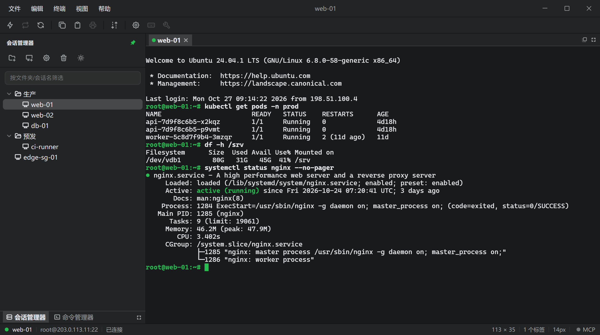
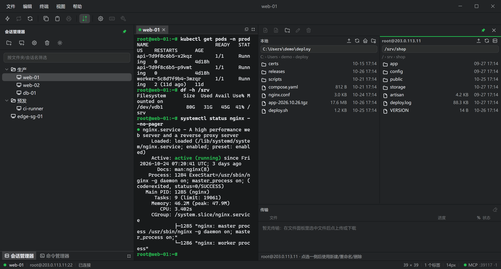

  

  # OneCRT
  ### 跨平台 ssh终端

   
  会话树 + 终端标签页  
   
  文件面板（SFTP）与传输区

## 功能

- **会话管理**：文件夹 + 会话树，支持过滤、双击连接、右键菜单（剪切 / 复制 / 粘贴、查找、重命名、删除、属性），树结构存 JSON。
- **导入外部配置**：读 SecureCRT 或 WinSCP 导出的会话文件，连同分组层级并入当前会话树。两种格式都不含可用的明文口令，导入的会话在连接时补凭据。第三方标识的来源与权利人见 NOTICE.md。
- **快速连接与认证**：Public Key / Password / Keyboard Interactive 三种方式，顺序即后端尝试顺序；私钥支持 OpenSSH 格式与 `~` 展开；勾选存储的口令在 Windows 上经 DPAPI 加密后落盘。
- **终端标签页**：真实 SSH PTY，自适应尺寸、多会话并行，标签显示连接状态；空闲保活在 SSH 层做。
- **命令库**：与会话树共用左侧停靠区。命令的显示名与实际发送文本分开存储，允许多行；可广播给全部就绪标签页或只发给当前可见的那个。
- **文件面板**：应用内右侧分栏，本地 + 远端双栏，上传 / 下载 / 新建目录 / 重命名 / 删除。
- **MCP 服务**：勾选后在 `127.0.0.1:39117/mcp`（端口可改）起一个 Streamable HTTP 的 MCP server，把已存会话作为工具开放给外部智能体（Qoder / Claude Desktop / Cursor），设置弹窗里一键复制可直接粘进客户端的 `{ mcpServers: { onecrt: … } }` JSON。六个工具：`sessions_list`、`terminals_list`、`exec`、`send`、`read`、`close`。`exec` 按会话复用同一个 shell，`cd` 与 `export` 跨调用有效，单次输出上限 64 KB、超出部分给出续读偏移。默认关闭、只监听回环、逐请求校验 `Authorization: Bearer <token>`；智能体只能点用应用已存的凭据，既收不到也看不到口令本身。
- **深浅两套主题**：配色 token 集中在 `src/styles.css`，界面与终端读同一组 CSS 变量，切换时终端前景/背景/光标/选区/ANSI 色一起跟上。

## 已知取舍

- 界面按同类终端的形态还原，但**只实现 SSH2**：协议下拉里的 SSH1 / Telnet / Telnet TLS / Local Shell / RDP / Serial / TAPI / Rlogin / Raw 一律置灰。
- 首次连接自动接受服务器主机密钥，不做指纹确认。
- 菜单与右键列全条目，其中打印、键盘映射、端口转发、标签组、多窗口、SFTP 会话一类是置灰占位，尚未实现。
- 不做断线自动重连：断线只给提示，按回车重连；空闲掉线靠 SSH 层保活压。
- MCP 只覆盖 SSH 终端这一层：没有把 SFTP 读写做成工具；agent 用的是无头会话（`mcp-` 前缀的 terminal id），不进布局、不出现在标签页，也看不到用户自己开着的标签；关掉开关会连带拆掉 agent 遗留的 shell。
- 本工具面向内网运维场景，不建议用在对外分发的机器上。
- 明亮主题下启动瞬间原生标题栏仍偏暗，要等前端 `setTheme` 生效才纠正（窗口底色已与深色 `--bg` 对齐，深色主题不再有跳变）。
