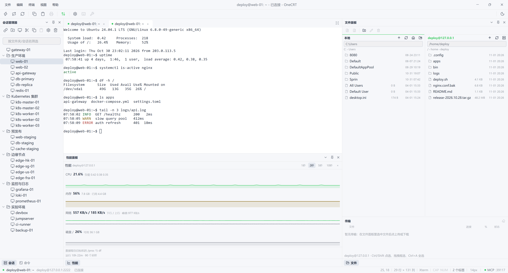
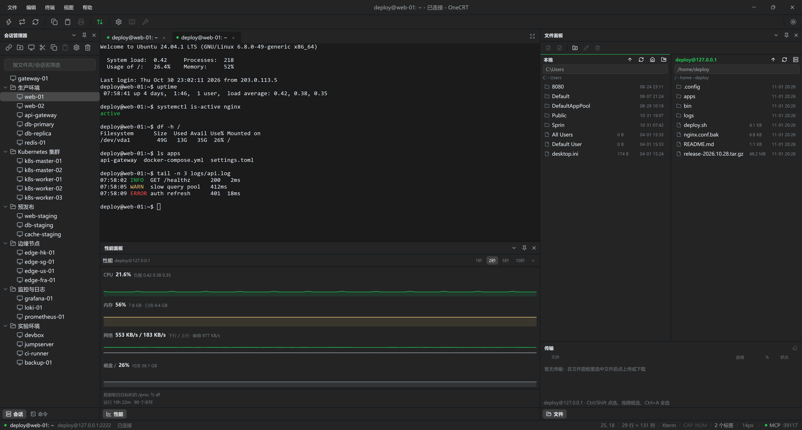

  
  <h1>OneCRT</h1>
  
最后一个下一代 SSH 终端。

  
支持 Windows、Linux、MacOS

OneCRT 是纯 Rust 编写的 SSH 客户端，界面用 gpui 原生绘制。终端、SFTP 文件传输和主机性能面板落在同一个窗口里，会话树与命令库存成本机 JSON。

## 功能

- **会话管理**：文件夹 + 会话树，过滤、双击连接、右键菜单（剪切 / 复制 / 粘贴、查找、重命名、删除、属性），树结构存 JSON。
- **导入外部配置**：读 SecureCRT 或 WinSCP 导出的会话文件，连同分组层级并入当前会话树；同主机同端口的会话视为冲突，可选择覆盖口令。
- **快速连接与认证**：Public Key / Password / Keyboard Interactive，顺序即后端尝试顺序；私钥支持 OpenSSH 格式与 `~` 展开；Windows 上保存的口令经 DPAPI 加密后落盘。
- **终端标签页**：russh 建链 + alacritty 终端核心，窗口尺寸变化会同步远端 PTY，多会话并行；`Ctrl` + `+` / `-` / `0` 调字号，`F11` 全屏。
- **命令库与广播**：命令的显示名与实际发送文本分开存储，可多行；可广播给全部就绪标签页或只发给当前标签页。
- **文件面板（SFTP）**：本地 + 远端双栏，上传 / 下载 / 新建目录 / 重命名 / 删除。
- **性能面板**：通过目标机 `/proc` 与 `df` 采样，展示 CPU、内存、负载、网络速率、磁盘与运行时长。
- **MCP 服务**：默认关闭，开启后只监听 `127.0.0.1:39117/mcp`，把已存会话作为工具开放给外部智能体，逐请求校验 Bearer 令牌。
- **深浅主题与中英切换**：偏好写入 `ui.json`，重启后保留。
- **检查更新**：关于对话框里查询 GitHub 最新 Release，有新版本时给下载页（不自动替换正在运行的二进制）。

## 已知取舍

- 只实现 SSH2；首次连接自动接受主机密钥，不做指纹确认。
- 发布物是压缩包而非安装器，且未做代码签名（Windows SmartScreen / macOS Gatekeeper 会提示）。
- 检查更新只提示新版本并打开下载页，不做自动安装。
- MCP 只覆盖 SSH 终端；SFTP 未开放为工具。面向内网运维，不建议用在外部分发的机器上。